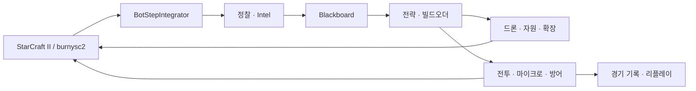

# Swarm Control · WickedZergBotPro

**StarCraft II 저그 AI 봇 — 정찰, 경제, 전투 제어와 강화학습을 연결하는 군집 제어 연구 프로젝트.**

[](https://github.com/sun475300-sudo/Swarm-control-in-sc2bot/actions/workflows/core-readiness.yml)
[](https://github.com/sun475300-sudo/Swarm-control-in-sc2bot/actions/workflows/empty-logger-guard.yml)

[빠른 시작](#빠른-시작) · [실제 경기 검증](#실제-경기-검증) · [AI Arena 패키지](#ai-arena-패키지) · [구조](#구조) · [계획과 기록](#계획과-기록)

## 검증 상태

<!-- VERIFIED-STATUS:START -->

검증 시각: 2026-11-07T21:31:59.114639+00:00 · 소스: `1fc396eff9d0`

| 검증 항목 | 결과 |
|:---|:---|
| 봇·도구 테스트 | 782 통과 / 0 실패 / 0 오류 / 0 건너뜀 (총 782) |
| 실제 SC2 경기 | 미검증 — 실제 경기 결과가 제공되지 않았습니다 |

단위 테스트 통과와 실제 경기 승률은 별도 결과입니다. 대회 승리를 보장하지 않습니다.

<!-- VERIFIED-STATUS:END -->

현재 SC2 Linux 배포 호스트 `blzdistsc2-a.akamaihd.net` 접근은 클라우드 네트워크 정책에 의해 HTTP 403으로 차단되어 실제 경기를 실행하지 못했습니다. 게임 설치와 맵을 확보한 뒤 아래 실제 경기 검증을 별도로 실행해야 합니다.

목표는 **Medium AI 상대 승률 90% 이상과 AI Arena 출전**입니다. 달성 여부는 상대 종족·난이도·맵·게임 버전을 기록한 실제 경기 결과로 판단합니다.

### 대회 성적 출처

사용자가 제공한 [AI Arena 봇 통계 페이지](https://aiarena.net/competitions/stats/3116/overview/winsbytime)를 대회 성적 확인 출처로 기록합니다.
현재 이 클라우드에서는 `aiarena.net` 접속이 허용되지 않아 페이지 내용과 봇의 등록 정보·경기 수·승률은 아직 확인하지 못했습니다.
접근이 가능해지면 등록된 봇 이름과 대회·버전·집계 기간을 확인하고, 실제 경기 결과를 로컬 테스트 결과와 구분해 기록합니다.

## 빠른 시작

Python **3.11**을 권장합니다. 핵심 봇 테스트는 SC2 설치나 외부 API 키 없이 실행할 수 있습니다.

```bash
git clone https://github.com/sun475300-sudo/Swarm-control-in-sc2bot.git
cd Swarm-control-in-sc2bot
python3.11 -m venv .venv
source .venv/bin/activate
python -m pip install -r wicked_zerg_challenger/requirements.txt \
  -r requirements-dev.txt pyyaml sc2reader aiohttp pytest-cov
export PROTOCOL_BUFFERS_PYTHON_IMPLEMENTATION=python
export MPLBACKEND=Agg
python -m pytest wicked_zerg_challenger/tests --timeout=120
```

Windows PowerShell에서는 가상환경을 `.venv\Scripts\Activate.ps1`로 활성화하고, 환경 변수를 다음과 같이 설정합니다.

```powershell
$env:PROTOCOL_BUFFERS_PYTHON_IMPLEMENTATION = "python"
$env:MPLBACKEND = "Agg"
```

루트 `requirements.txt`에는 JARVIS·Discord·거래 서비스 등의 의존성도 포함됩니다. 위 명령은 봇 개발에 필요한 범위를 설치합니다. Torch/CUDA 학습과 다른 서비스는 별도 설정이 필요합니다.

## 실제 경기 검증

먼저 StarCraft II와 사용할 맵을 설치합니다. Linux 패키지와 라이선스 안내는 [Blizzard 공식 API 문서](https://github.com/Blizzard/s2client-proto#downloads)를 확인하세요. `SC2PATH`는 게임 설치 루트이며, 맵은 그 아래 `Maps/`에 둡니다.

게임을 실행하지 않고 경기 계획부터 확인합니다.

```bash
export SC2PATH=/path/to/StarCraftII
python wicked_zerg_challenger/run_mass_test.py \
  --opponent Terran --difficulty Medium --games 10 \
  --maps AbyssalReefLE,AscensiontoAiurLE,OdysseyLE --dry-run
```

같은 계획으로 실제 경기를 실행하고 승률 기준을 검사합니다.

```bash
python wicked_zerg_challenger/run_mass_test.py \
  --opponent Terran --difficulty Medium --games 10 \
  --maps AbyssalReefLE,AscensiontoAiurLE,OdysseyLE \
  --seed 0 --max-game-time 1800 --min-win-rate 90 \
  --output data/reports/medium-terran.json \
  --replay-dir data/replays/medium-terran
```

- `--min-win-rate`는 **0~100 사이의 백분율**입니다. 무승부는 승리로 계산하지 않습니다.
- `--max-game-time`은 경기당 **게임 내 시간(초)**이며, 기본값은 1800입니다. 실제 경과 시간 제한과 다릅니다.
- `--seed`는 첫 경기의 SC2 난수 시드이며 이후 경기마다 증가합니다.
- 런타임·맵·경기 오류나 승률 기준 미달은 실패 종료 코드로 전달됩니다. dry-run은 경기 결과 파일을 생성하지 않습니다.

Terran·Protoss·Zerg를 각각 평가하고 JSON과 리플레이를 함께 보관하세요. 한 종족·한 맵의 결과만으로 전체 승률이나 대회 경쟁력을 판단하지 않습니다.

## AI Arena 패키지

저장소 루트에서 업로드 ZIP을 만듭니다.

```bash
python create_arena_package.py --output-dir dist \
  --name WickedZergBotPro_Arena.zip --no-open
```

패키지에는 `run.py`, `ladderbots.json`, 대회용 의존성과 봇 실행 모듈이 포함됩니다. `local_training/`에는 실제 추론·경제 모듈도 있으므로 실행 소스를 유지하고 생성된 학습 산출물은 제외합니다.

[AI Arena](https://aiarena.net)의 계정과 참가 절차를 확인한 뒤 Python / Zerg 봇으로 업로드합니다. ZIP 생성과 단위 테스트 통과는 대회 서버 접속 또는 경기 승리를 입증하지 않습니다.

## 구조



| 경로 | 역할 |
| --- | --- |
| [`wicked_zerg_challenger/`](wicked_zerg_challenger/) | 핵심 봇, 매니저, 정찰·경제·전투 로직 |
| [`wicked_zerg_challenger/local_training/`](wicked_zerg_challenger/local_training/) | RL 추론·학습 및 경제/전투 조정 모듈 |
| [`wicked_zerg_challenger/tests/`](wicked_zerg_challenger/tests/) | 봇 동작과 회귀 검증 |
| [`run.py`](run.py), [`ladderbots.json`](ladderbots.json) | AI Arena 진입점과 봇 메타데이터 |
| [`create_arena_package.py`](create_arena_package.py) | 대회 업로드 패키징 |
| [`.github/workflows/`](.github/workflows/) | GitHub Actions 검사와 자동화 |

저장소에는 Rust·TypeScript 및 다양한 언어/도구 예제도 있습니다. 핵심 봇 실행에 필요한 구성과 별도로 관리하며, 전체 목록과 이전 포트폴리오 설명은 [기존 README 보관본](docs/archive/README_PORTFOLIO.md)에서 확인할 수 있습니다.

## 주기적 상태 갱신

`.github/workflows/core-readiness.yml`은 매일 **18:00 UTC / 다음 날 03:00 한국 시간**과 수동 실행으로 봇 테스트를 검증합니다. 테스트가 1개 이상 실행되어 모두 통과하면 `scripts/update_readme_status.py`가 이 페이지의 검증 상태 영역과 `data/reports/readiness.json`만 갱신하고 `main`에 커밋합니다. 실제 경기 기록 없이 승률을 생성하지 않습니다.

예약 실행과 자동 업로드는 해당 워크플로가 기본 브랜치에 게시되고, 저장소의 GitHub Actions 및 쓰기 권한이 활성화된 뒤 작동합니다.

같은 워크플로는 검증한 대회 제출 ZIP을 `arena-bot-package` 아티팩트로 보관합니다.
원격 개발 브랜치는 `main` 하나로 정리했으며, 이전 540개 브랜치의 작업은 원격 보관 태그로 유지합니다. [보관·복구 안내](docs/BRANCH_POLICY.md)를 참고하세요.

## 계획과 기록

- [대회 작업 현황](docs/COMPETITION_PLAN.md): 이번 구현, 실제 경기의 남은 조건, 기존 계획 문서별 미완료 범위.
- [ROADMAP.md](ROADMAP.md): 경제·정찰·전투·RL 개선 계획. 각 완료 여부는 구현과 검증 결과를 함께 확인합니다.
- [MASTER_TODO_SC2.md](MASTER_TODO_SC2.md): 과거 PR·CI 백로그 조사 기록.
- [PLAN-NIGHTLY.md](PLAN-NIGHTLY.md): 이전 주기 작업 및 테스트 기록.
- [기존 README 보관본](docs/archive/README_PORTFOLIO.md): 이전 장문 소개, 실험 목록과 과거 수치. 현재 검증 상태는 이 페이지 상단을 기준으로 합니다.

새로운 변경은 코드·테스트·측정 결과를 함께 남깁니다. 경기 성적에는 평가 조건을 기록하고, 실패·건너뜀·미실행을 통과로 표시하지 않습니다.
